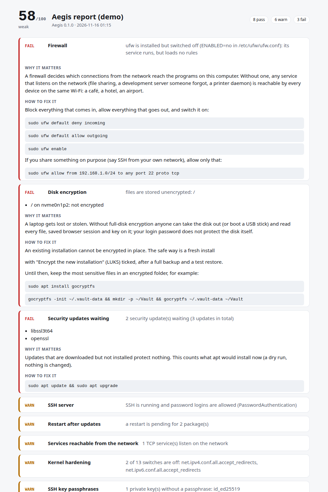
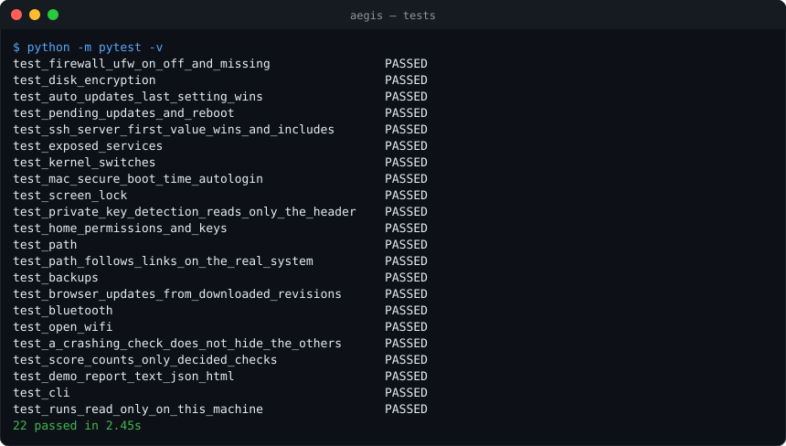

# Aegis

[](https://github.com/fas0ftware/aegis/actions/workflows/ci.yml)


A read-only security check for a Linux laptop. It looks at the things that matter when
the laptop is lost, stolen or on a café's Wi-Fi (firewall, disk encryption, updates, SSH,
keys, screen lock, backups) and for every finding says **why it matters** and **how to
fix it**, with the commands. It never changes anything, never asks for a password and
never guesses: what it cannot see without root is reported as *unknown*.

Named after the shield of Athena.



## Quick start

```bash
git clone https://github.com/fas0ftware/aegis && cd aegis
python3 -m aegis                 # check this machine
python3 -m aegis --save          # ...and keep the result for Olympos
python3 -m aegis explain firewall
python3 -m aegis report aegis.html   # the same as one page (like the screenshot)
python3 -m aegis --demo          # a made-up laptop, for trying it
```

No dependencies beyond Python 3.11. Tested on Ubuntu; checks that need apt, GNOME or
systemd say *unknown* elsewhere.

## The checks

| Id | Severity | What it looks at |
|---|---|---|
| `firewall` | high | ufw switched on (`ENABLED=yes`, not just its service running), or firewalld |
| `disk-encryption` | high | `/` and `/home` on a LUKS device (`lsblk`) |
| `auto-updates` | high | unattended-upgrades installed and on (last apt setting wins) |
| `pending-updates` | high | security updates waiting (`apt-get -s upgrade`, a dry run) |
| `ssh-server` | high | if sshd runs: password and root logins (first value wins, `Include` read in place, `Match` blocks left out) |
| `reboot` | medium | a restart pending after updates, and for which packages |
| `exposed-services` | medium | TCP services listening on all addresses (`ss`) |
| `kernel` | medium | 13 sysctl switches: ASLR, kptr/dmesg restrict, ptrace scope, BPF, protected links/FIFOs, SYN cookies, rp_filter, redirects |
| `mac` | medium | AppArmor enabled or SELinux enforcing |
| `screen-lock` | medium | GNOME locks the screen, and after how long |
| `autologin` | medium | GDM or LightDM automatic login |
| `home-permissions` | medium | home, `~/.ssh`, `~/.gnupg`, private keys and `authorized_keys` modes |
| `ssh-keys` | medium | private keys without a passphrase (only the key header's cipher name is decoded) |
| `path` | medium | `.` or world-writable folders in `PATH` (symlinks such as `/bin` are followed) |
| `backups` | medium | the newest good backup in [Mnemosyne](https://github.com/fas0ftware/mnemosyne)'s status file |
| `secure-boot` | low | Secure Boot on (`mokutil`) |
| `time-sync` | low | the clock synchronized (`timedatectl`) |

The score counts only checks that were decided: pass is full weight, warn half, fail
none (high 3, medium 2, low 1). *Info* and *unknown* do not count.

## Output

- terminal text with the fixes (`--no-fixes` to leave them out), `--json`, or one HTML
  page with a strict Content-Security-Policy and no scripts (light and dark);
- `--only firewall,ssh-keys` to run some checks; `--strict` exits 1 if any check fails;
- `--save` writes `~/.local/state/aegis/status.json` (mode 600) for dashboards such as
  [Olympos](https://github.com/fas0ftware/olympos). `contrib/systemd/` has a daily timer.

## Privacy and safety

- Only reads. Commands run without a shell, with fixed arguments and a 5 s timeout.
- Private keys: Aegis reads the first bytes of the header to find the cipher name
  (`none` means no passphrase). It never prints, stores or sends key material.
- No network access. Reports and the status file stay on the machine; `*.html` is in
  `.gitignore` so a report of your own laptop is not committed by accident.

## Tests

```bash
pip install -r requirements-dev.txt
python -m pytest -v
```



Every check runs against made-up machines (a fake probe with files, modes and command
outputs): ufw on and off, LUKS under LVM, sshd with includes, Match blocks and a
self-include, keys in OpenSSH, PEM and PKCS#8 form, sticky `/tmp` in `PATH`, a symlinked
`/bin` on the real file system, stale and missing backups, a check that crashes, HTML
escaping. CI also runs Aegis on its own runner (read-only) and bandit.

## Roadmap

- ~~Olympos shows the Aegis score and the failing checks.~~ Done in Olympos 0.5 (reads `--save`'s status file).
- More checks: Bluetooth discoverable, USB guard, browser updates, failed logins (as root).
- Fedora (dnf-automatic) and Arch support for the update checks.

## License

MIT
